<p align="center">
  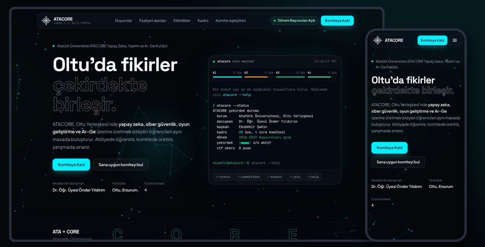
</p>

<h1 align="center">ATACORE — Kulüp Web Sitesi</h1>

<p align="center">
  <b>Atatürk Üniversitesi ATACORE Yapay Zeka, Yazılım ve Ar-Ge Kulübü</b> için<br>
  tasarlanıp geliştirilen ve yayına alınan resmi web sitesi.
</p>

<p align="center">
  <a href="https://ata-core.com"><b>🌐 ata-core.com</b></a>
  &nbsp;·&nbsp; Oltu Yerleşkesi, Erzurum &nbsp;·&nbsp; Saf HTML/CSS/JavaScript &nbsp;·&nbsp; Cloudflare &nbsp;·&nbsp; Google Apps Script
</p>

---

## Proje hakkında

ATACORE (*ATA + CORE: Cybernetics, Optimization, Research & Engineering*), Atatürk Üniversitesi Oltu Yerleşkesi'nde yapay zeka, siber güvenlik, oyun geliştirme ve Ar-Ge üzerine çalışan bir öğrenci kulübü. Sitenin üç temel görevi var:

- **Öğrenciler için:** Kulübü, faaliyet alanlarını ve komiteleri tanıtmak; "hangi komite bana uygun?" sorusuna cevap verip başvuruyu birkaç tıklamaya indirmek.
- **Yönetim kurulu için:** Kod bilgisi gerektirmeden duyuru yayınlamak ve gelen başvuruları tek bir tabloda takip etmek.
- **Kulübün kimliği için:** Teknik bir kulübe yakışan, etkileşimli ve şablon görünmeyen bir vitrin sunmak.

Tasarımdan alan adı bağlamaya, duyuru ve başvuru altyapısından yayına almaya kadar proje uçtan uca hayata geçirildi.

## Öne çıkanlar

- **Etkileşimli ATACORE CLI terminali** — `atacore --status`, `--committees`, `--events`, `--news`, `--join` gibi komutlar yazılarak ya da tıklanarak çalışır; komut geçmişi (↑ ↓) ve Tab ile otomatik tamamlama vardır.
- **Fareye tepki veren "Neural Core" arka planı** — HTML5 Canvas ile çizilen, düğümler arasında sinyal taşıyan sinir ağı animasyonu. Ekran dışındayken ve sekme arka plandayken durur.
- **8 faaliyet alanı** — Fareyi takip eden ışık ve 3B eğim efektli, asimetrik "bento" ızgara.
- **Amiral gemisi etkinlikler** — Game Jam geri sayımı, tarayıcıda çözülebilen 3 görevli **Cyber Arena CTF** provası ve TÜBİTAK 2209-A/B, 2242, ÜNİDES, TEKNOFEST için adım adım **Proje Fabrikası** yol haritası.
- **Filtrelenebilir kadro** — Organizasyon şeması, komite sekmeleri, başkanlık üçlüsü ve komite başkanları vurgusu; Türkçe karakterlerden bağımsız arama ("sahin" yazınca "Şahin" bulunur).
- **"Hangi komite sana uygun?" eşleştiricisi** — 5 soruluk test; sonuca göre komiteyi önerir ve başvuru formunu o komite seçili açar.
- **Kod gerektirmeyen duyuru sistemi** — Yönetim kurulu Google E-Tablolar'a bir satır ekler, duyuru sitede görünür. Sabitleme, gizleme ve tarih sıralaması desteklenir.
- **Başvuru formu** — KVKK onay kutusu, alan doğrulama ve taslağı tarayıcıda saklama. Gönderilen başvuru tabloya yazılır ve kulüp e-postasına bildirim gider. Bağlantı kurulamazsa başvuru, hazır bir e-posta olarak gönderilebilir.
- **Mobil uyum ve erişilebilirlik** — 360 px'ten geniş ekranlara kadar yatay taşma yok; klavyeyle gezinme, görünür odak çerçevesi, ekran okuyucu etiketleri ve "hareketi azalt" tercihine uyum.

## Ekran görüntüleri

### Masaüstü

| Ana sayfa ve CLI terminali | Duyurular |
|:---:|:---:|
| 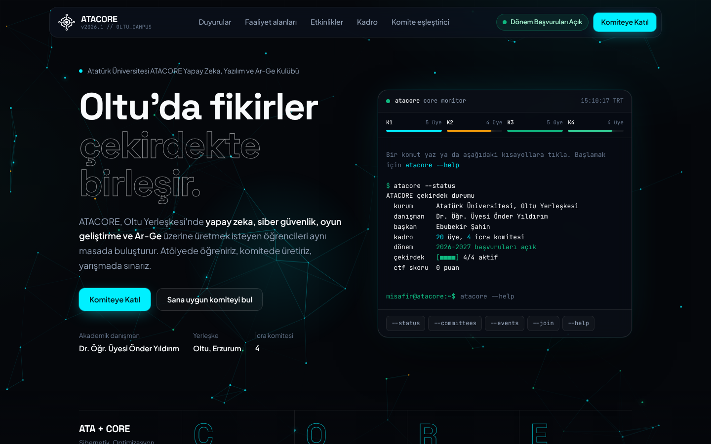 | 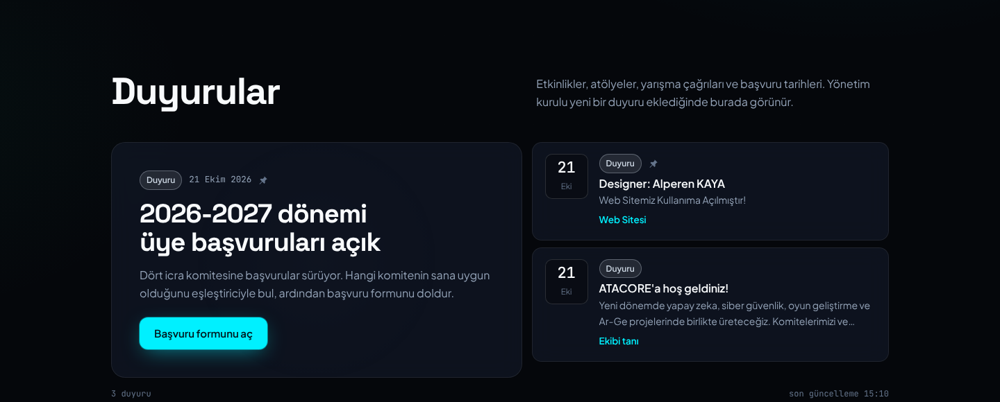 |
| **Faaliyet alanları** | **Cyber Arena CTF** |
| 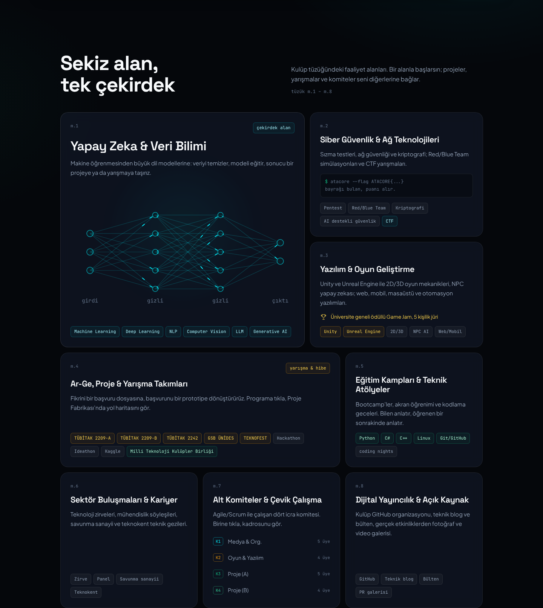 | 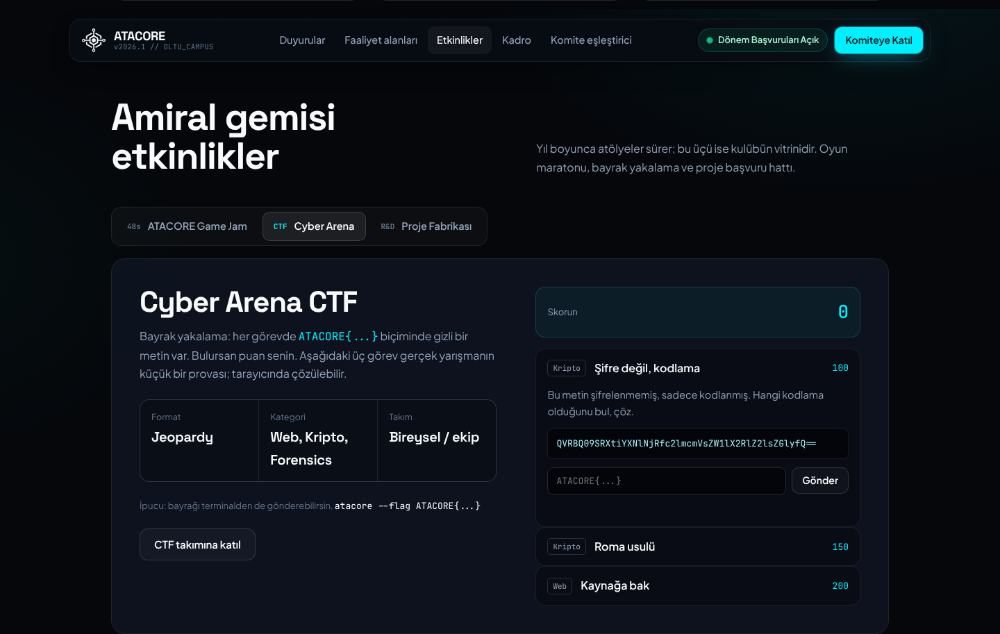 |
| **Komite eşleştirici** | **Başvuru formu** |
| 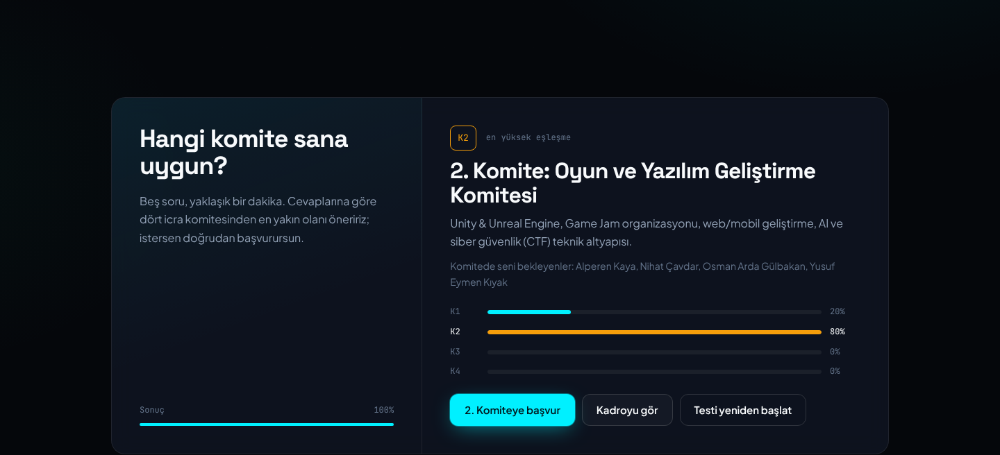 | 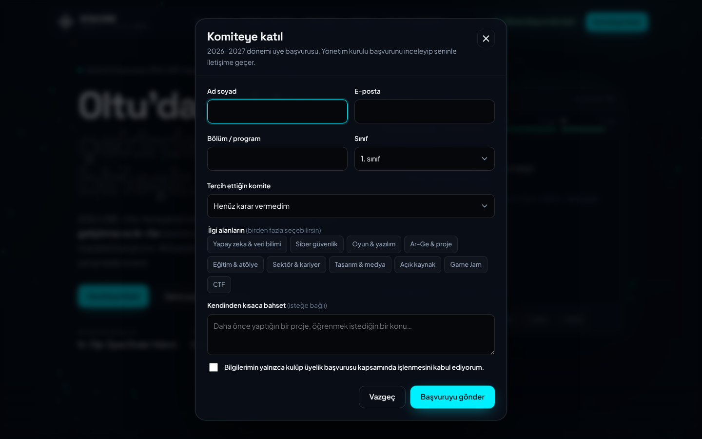 |

<p align="center">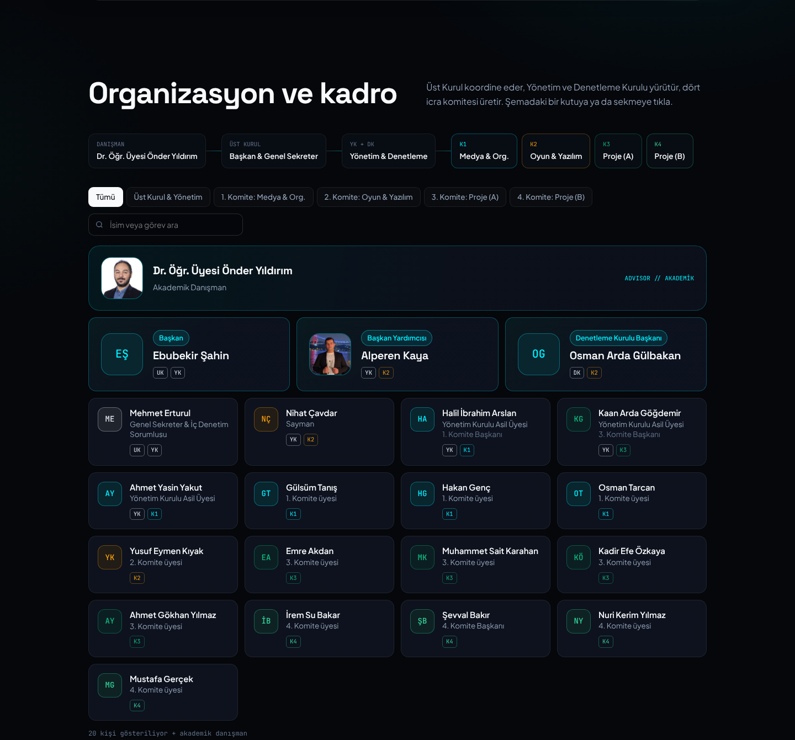<br><sub>Organizasyon şeması ve filtrelenebilir kadro</sub></p>

### Mobil

| Ana sayfa | Menü | Terminal | Kadro | Duyurular |
|:---:|:---:|:---:|:---:|:---:|
| 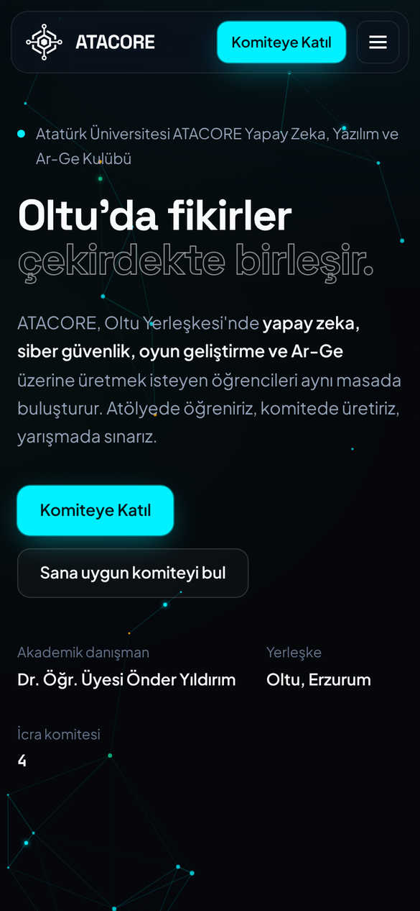 | 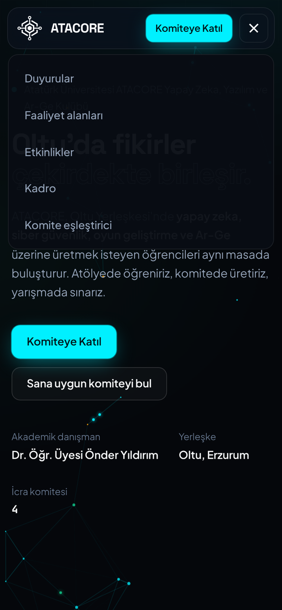 | 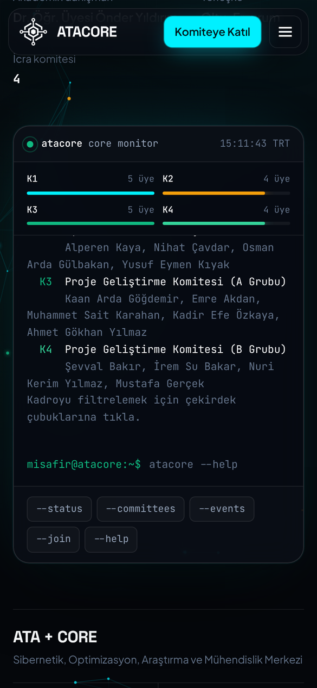 | 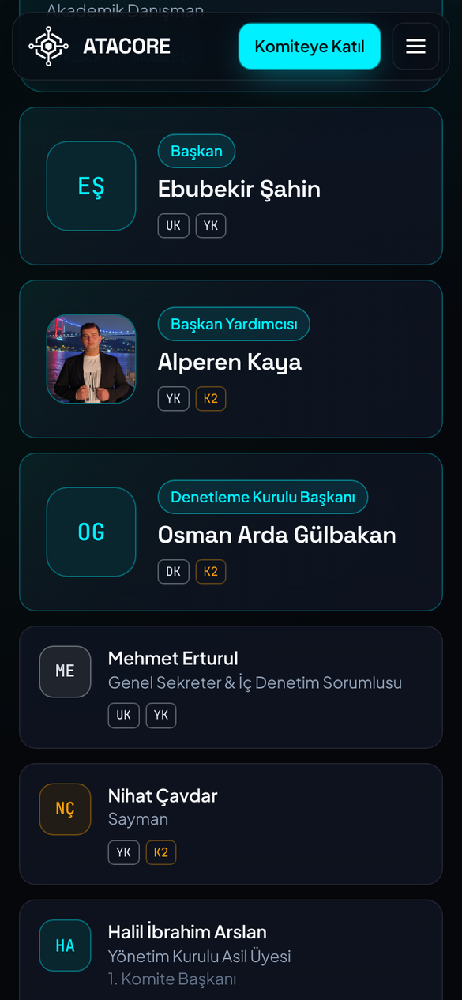 | 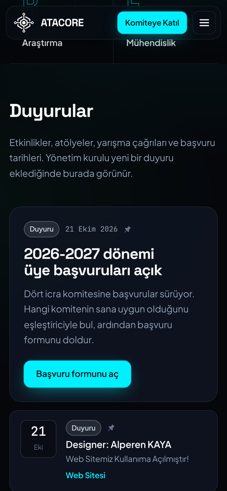 |

## Kullanılan teknolojiler

| Katman | Teknoloji |
|---|---|
| **Diller** | HTML5, CSS3, JavaScript (ES2022), Google Apps Script |
| **Ön yüz** | Çatı (framework) kullanılmadan saf HTML/CSS/JavaScript · CSS değişkenleri ve `color-mix()` · HTML5 Canvas 2D · IntersectionObserver · yerel `<dialog>` öğesi |
| **Barındırma** | Cloudflare Workers statik varlıkları (küresel CDN, otomatik HTTPS) · `ata-core.com` ve `www` özel alan adları |
| **Veri** | Google E-Tablolar — "Duyurular" ve "Başvurular" sekmeleri |
| **Sunucu tarafı** | Google Apps Script web uygulaması: `GET` duyuruları okur, `POST` başvuruyu tabloya yazar |
| **Bildirim** | Apps Script `MailApp` ile her yeni başvuruda kulüp e-postasına bildirim |
| **Yazı tipleri** | Space Grotesk, Plus Jakarta Sans, JetBrains Mono (Google Fonts, OFL lisanslı) |
| **Test** | Playwright (masaüstü ve mobil ekran boyutlarında otomatik tarayıcı testleri), Chrome DevTools |

## Mimari

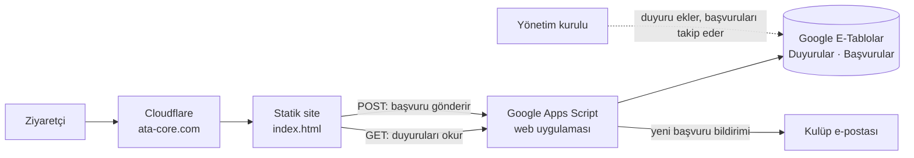

## Güvenlik

- **Hücre enjeksiyonuna karşı koruma:** Formdan gelen ve `=`, `+`, `-`, `@` ile başlayan değerler tabloya formül olarak değil, düz metin olarak yazılır. Alan uzunlukları sınırlanır.
- **Spam koruması:** Formda kullanıcıların görmediği bir tuzak alan vardır; bu alanı dolduran otomatik gönderimler kaydedilmez.
- **Eşzamanlı yazma:** Aynı anda gelen başvurular birbirini ezmesin diye kilit (`LockService`) kullanılır.
- **Güvenli içerik gösterimi:** Tablodan gelen duyuru metinleri sayfaya kaçış karakterleriyle eklenir. Bağlantılarda yalnızca `https://` ve sayfa içi `#` adreslerine izin verilir; `javascript:` gibi adresler yok sayılır.
- **Yedek davranış:** Tabloya ulaşılamazsa son başarılı duyurular gösterilir; başvuru ise kaybolmadan e-posta olarak gönderilebilir.

## Bu depoda neler var?

```
kaynak/
├── index.html                  Sitenin tek kaynak dosyası (HTML + CSS + JavaScript)
├── logo-192.png                Kulüp logosu (site simgesi)
└── google-apps-script/
    ├── Kod.gs                  Duyuruları okuyan ve başvuruları tabloya yazan Apps Script
    └── KURULUM.md              Tablo ve Apps Script kurulum rehberi
ekran-goruntuleri/              Masaüstü ve mobil ekran görüntüleri
```

> **Not:** Sitenin güvenliği için yayındaki Apps Script adresi, tablo bağlantıları, Cloudflare yapılandırması ve hesap bilgileri bu depoda **yer almaz**. `kaynak/index.html` içindeki `appsScriptUrl` boş bırakılmıştır; bu haliyle site varsayılan duyuruyla çalışır. Kulüp üyelerinin fotoğrafları da depoya eklenmemiştir; fotoğrafı olmayan kartlarda baş harfler gösterilir.

## Yerelde çalıştırma

Derleme adımı yoktur. `kaynak/index.html` dosyasını tarayıcıda açmak yeterlidir. Duyuruları ve başvuruları kendi tablona bağlamak için [`kaynak/google-apps-script/KURULUM.md`](kaynak/google-apps-script/KURULUM.md) adımlarını izle.

## Geliştirme süreci

Tasarım, kodlama, test ve yayına alma süreçleri yapay zekâ destekli olarak yürütüldü. Her değişiklik gerçek tarayıcıda; masaüstü ve mobil ekran boyutlarında, konsol hataları ve etkileşim testleriyle doğrulandı. Duyuru ve başvuru akışı canlı Google altyapısı üzerinde uçtan uca test edildi.

## Telif

© 2026 Atatürk Üniversitesi ATACORE Yapay Zeka, Yazılım ve Ar-Ge Kulübü — Tüm hakları saklıdır.
Kodlar inceleme amacıyla paylaşılmıştır; izin alınmadan kopyalanıp kullanılamaz.
ATACORE adı ve logosu kulübe aittir. Ekran görüntülerinde yer alan kişi adları ve fotoğrafları kulüp üyelerine aittir.
Yazı tipleri SIL Open Font License (OFL) ile lisanslıdır.

---

<p align="center">Geliştiren: <b>Alperen Kaya</b></p>
